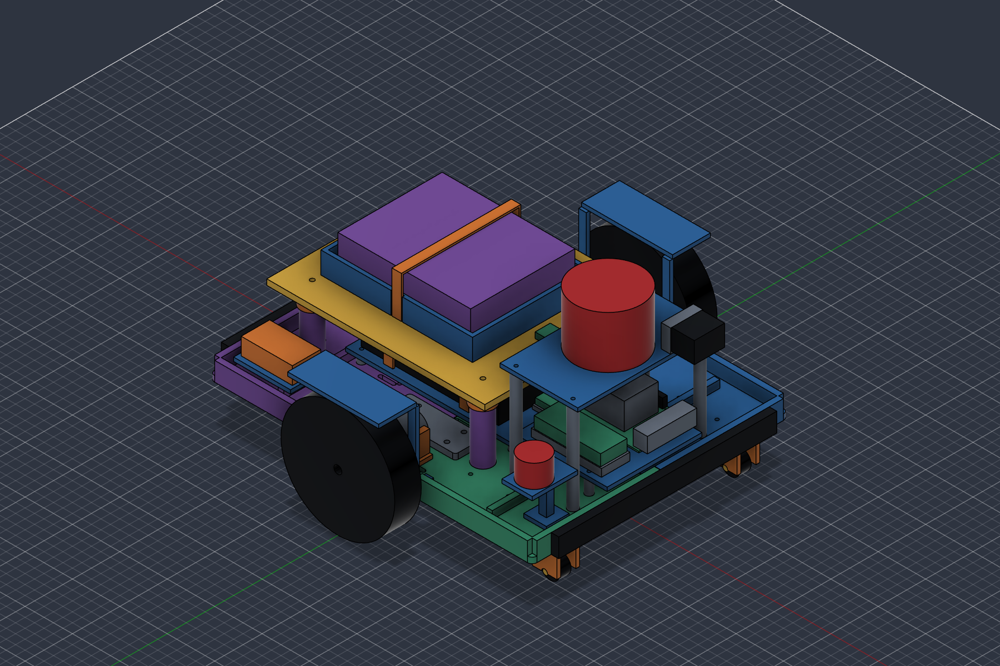
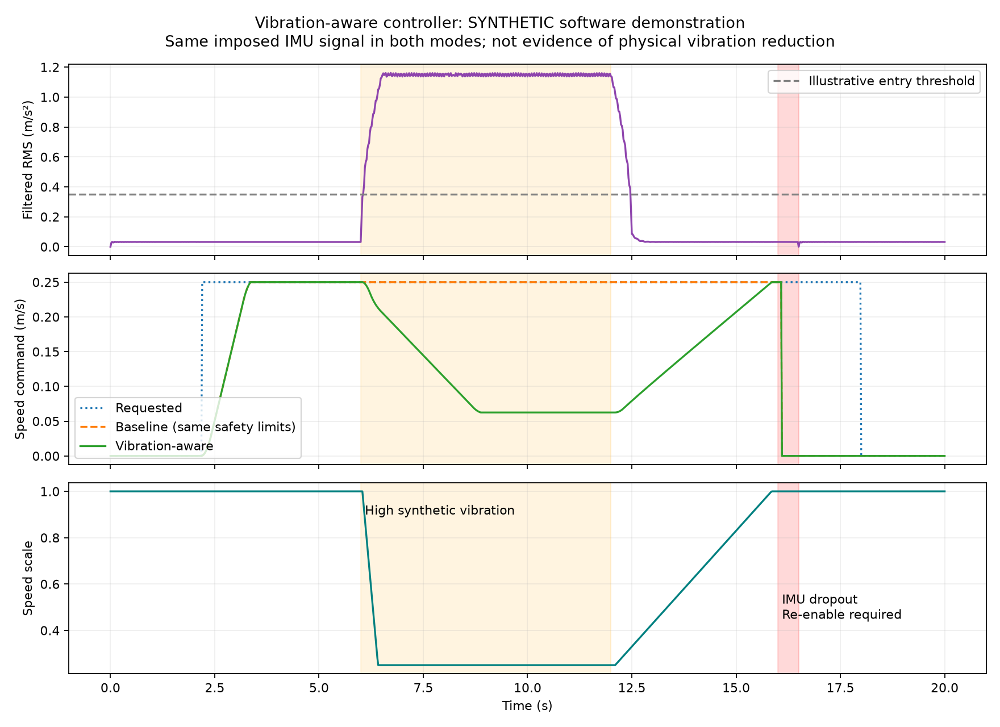

# Vibration-Aware Autonomous Mobile Robot

An Individual Major Project investigating whether payload-IMU feedback and bounded motion adaptation can reduce vibration during indoor transport of a representative fragile payload.

The robot is a **custom two-wheel differential-drive platform with a rear castor**, a passive isolated payload deck concept and a **1 kg total carried-load target**. It is not a TurtleBot. A Raspberry Pi 5 is available; ROS 2 navigation and hardware integration are planned. Conservatively budget the isolated deck, carrier, restraint, dummy payload and carried instrumentation within that 1 kg; it is not total robot mass or a demonstrated capacity.

**Current stage: IMP Part B, prototype CAD and offline software testing. Physical construction and experimental validation have not been completed.**



## What is here

| Folder | Contents | Evidence status |
| --- | --- | --- |
| [cad/full_robot_v04](cad/full_robot_v04) | Native Fusion archive, source/Fusion STEP exports, coloured previews, geometry sources and verification reports | 87 valid solids; Fusion export/reopen and discrete castor checks recorded; hardware fit and strength untested |
| [cad/printing_x1c_pla](cad/printing_x1c_pla) | Ten STL/3MF models, downloadable chassis print package, fit coupon and Bambu Studio guide | Closed meshes and nominal bed fit checked; unsliced, not printer-tested |
| [cad/chassis_v03](cad/chassis_v03) | Split chassis STEP assembly, individual STLs, CAD generator, previews and geometry checks | Validated file geometry; mounting fit and load capacity untested |
| [cad/concept_v02](cad/concept_v02) | Earlier Fusion assembly, STEP, coloured subsystem sheets and Fusion generator | Historical full-robot concept, not fabrication-ready |
| [software/vibration_aware_control](software/vibration_aware_control) | Python controller core, ROS 2 adapter, configuration, unit tests and synthetic demo | 20 offline tests passed; ROS runtime and hardware untested |
| [simulation/four_wheel_alternative](simulation/four_wheel_alternative) | MATLAB kinematics and analytical outputs for the earlier skid-steer alternative | Not the current two-wheel chassis model |
| [docs](docs) | Project status, next steps and repository scope | Planning documentation |

## Start here

- **Fusion:** open [Vibration_Aware_AMR_v04.f3d](cad/full_robot_v04/Vibration_Aware_AMR_v04.f3d). It is an actual exported/reopened native archive, containing imported solids rather than their original sketch history. Reference parameters do not regenerate them. Read [v04 revision notes](cad/full_robot_v04/REVISION_NOTES.md) before editing.
- **Printing:** download the [X1 Carbon PLA print package](cad/printing_x1c_pla/AMR_X1C_PLA_Print_Package.zip), then follow [START_HERE](cad/printing_x1c_pla/START_HERE.md). Begin with the 70 × 32 × 6 mm fit coupon; the four panels are about 169.8 × 134.8 mm. Confirmed setup: PLA 1.75 mm, physical plate 257 × 257 mm, printable volume 256 × 256 × 256 mm. Select the installed nozzle and actual plate surface in Bambu Studio, then slice. No G-code is supplied. The package covers the chassis base, not all v04 mounts.
- **Hardware:** see the dated [parts shortlist](docs/PARTS_SHORTLIST.md). Supplier candidates are not purchases or a final BOM, and their dimensions differ from the v04 placeholders.
- **Controller:** run the ROS-independent tests with Python 3.10 or newer:

```sh
cd software/vibration_aware_control
python -m unittest discover -s tests -v
python -m vibration_aware_control.demo
```

The tests and CSV demo require only Python's standard library. Install `matplotlib` if a regenerated chart is wanted. The existing demo outputs are already included.



Both demo modes receive the same imposed vibration input. The chart demonstrates command adaptation and a sensor-dropout stop; it does **not** demonstrate achieved physical vibration reduction.

## Planned architecture

Ubuntu 24.04 and ROS 2 Jazzy on the Pi 5; Gazebo Harmonic on the development PC; SLAM Toolbox, Nav2 with DWB, encoder/IMU odometry, ArUco docking and rosbag2 logging. A microcontroller handles wheel-speed control and an independent command watchdog. A hardwired emergency stop removes motor power independently of ROS.

The vibration-aware function adapts driving commands using payload acceleration. Passive elastomer isolation is planned. **Active vibration cancellation is not part of the core implementation.**

The planned experiment targets at least 20% lower RMS vibration with no more than 20% additional journey time. These are research targets, not results. Measurement definitions, gravity removal, matched-trial conditions and dataset counting must be fixed before trials.

## Before physical use

Confirm component dimensions, motor/driver ratings, battery and regulated power supplies, fasteners, print material, stability and laboratory risk controls. The CAD geometry checks are not FEA, proof-loading or a 1 kg capacity certification. The software is not safety-rated and must not be connected to powered wheels without supervised commissioning.

See [project status and next steps](docs/PROJECT_STATUS.md) for the current gaps. Academic submissions and personal forms are intentionally kept outside this repository. No new open-source licence has been selected.
