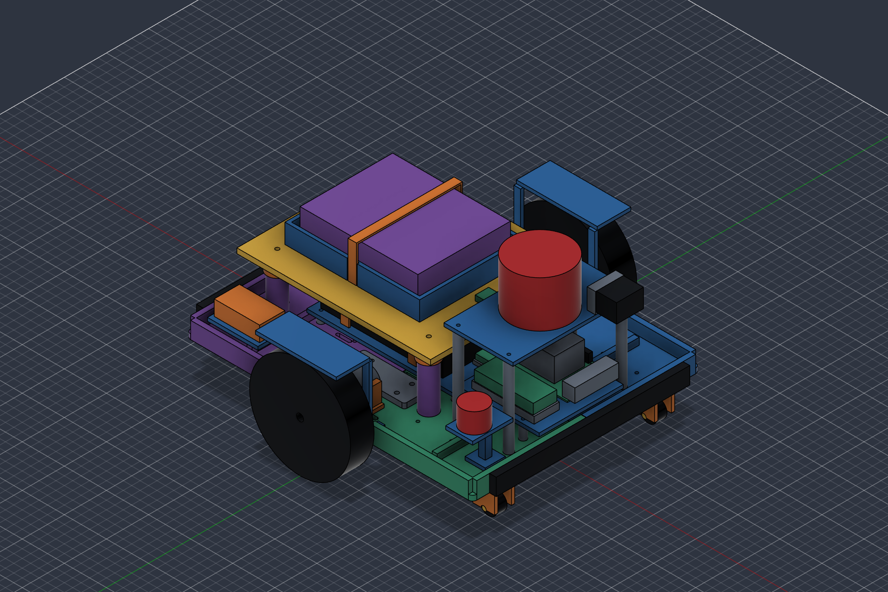

# Full robot v04 — concept prototype

Created and verified 2 October 2026. Read [REVISION_NOTES.md](REVISION_NOTES.md) for geometry, assumptions and unresolved interfaces.

- [Native Fusion archive](Vibration_Aware_AMR_v04.f3d): exported and reopened in Autodesk Fusion; 87 valid solid bodies with component colours. Imported solids do not recover a sketch-based feature history. Reference parameters do not regenerate geometry.
- [Source STEP](Vibration_Aware_AMR_v04.step) and [Fusion-exported STEP](Vibration_Aware_AMR_v04_Fusion.step).
- [Coloured assembly](Vibration_Aware_AMR_v04_Colored.png), [service view](Vibration_Aware_AMR_v04_Service_View.png), [side view](Vibration_Aware_AMR_v04_Side.png).
- `Geometry_Checks.json`, `Fusion_Verification.json`, `Export_Integrity.json` and `Castor_Sweep_Check.json`: recorded geometry/export checks, not hardware or structural tests.
- `STEP_PARTS/`: individual solids, including purchased-component clearance envelopes. Do not print these indiscriminately.
- `INPUT_CHASSIS/`: preserved v03 chassis inputs for reproducing this revision.



## Reproduction

The geometry generator requires CadQuery 2.8. From the repository root, run:

```sh
python cad/full_robot_v04/source/build_full_robot.py --out cad/full_robot_v04
python cad/full_robot_v04/source/check_castor_sweep.py
```

The first command rewrites source STEP/part/report outputs in this revision folder. It does not produce an F3D. To export/reopen a native archive, register the existing `source/` folder as the `AMRUpdatedAssembly` script in Fusion's Scripts and Add-Ins tool, keeping it in place beside this revision's files, then run it inside Fusion. Its `adsk` imports require Fusion, not ordinary Python. The exporter rewrites the F3D, Fusion STEP, preview images and Fusion verification report. Historical `Export_Integrity.json` must be rechecked separately if outputs change.

For printing, use the separate [X1 Carbon PLA chassis package](../printing_x1c_pla/START_HERE.md). It covers the chassis base retained in v04; motor mounts, payload interfaces and other v04 mounting concepts are not released print parts. Source/native metadata from 2 October predates the 4 October PLA confirmation; use the current printing guide for printer settings.
