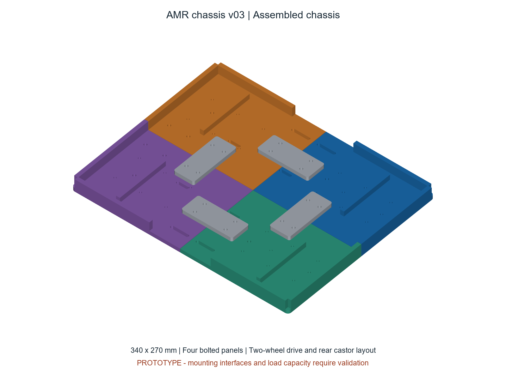

# X1 Carbon PLA chassis print files

Prepared 4 October 2026. These are the chassis-base parts preserved in the v04 assembly, plus a fit coupon. They are unsliced prototype models; actual printing and load capacity have not been validated.

- [Download the complete package](AMR_X1C_PLA_Print_Package.zip).
- [Read the Bambu Studio guide](START_HERE.md).
- Print the [STL fit coupon](STL/00_Hole_and_Slot_Fit_Coupon.stl) or [3MF fit coupon](3MF_Models/00_Hole_and_Slot_Fit_Coupon.3mf) first. They are alternate formats of the same part.
- [Part quantities and dimensions](PRINT_LIST.csv); [recorded mesh/file checks](Reference/PRINT_FILE_CHECKS.json).

Confirmed: Bambu Lab X1 Carbon, PLA 1.75 mm, physical plate 257 × 257 mm, printable volume 256 × 256 × 256 mm. Select the actual nozzle and plate surface in Bambu Studio. The 3MF files specify millimetres and model placement; they contain no Bambu machine/process preset or sliced G-code. Keep scale at 100% and flat bottoms on the plate. Print panels individually.

All ten STL meshes were checked as closed, consistently wound, single volumes, with dimensions matching the source print list. The 3MF geometry was reconstructed and compared with each STL. Nominal XY fit includes 5 mm margin per side; actual slicer exclusions still apply. Settings in the guide are provisional starting points, not certified structural specifications.

Parts 01–04 are panels, 05–08 are splice plates, and 09 is a castor adapter with a blank vendor interface. Motor-specific mounts, payload/isolation interfaces and other v04 mounting concepts require refinement before printing. Do not print purchased-component envelopes from the full robot STEP.
