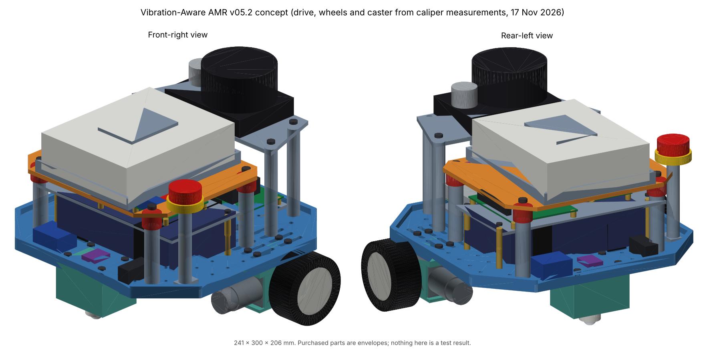
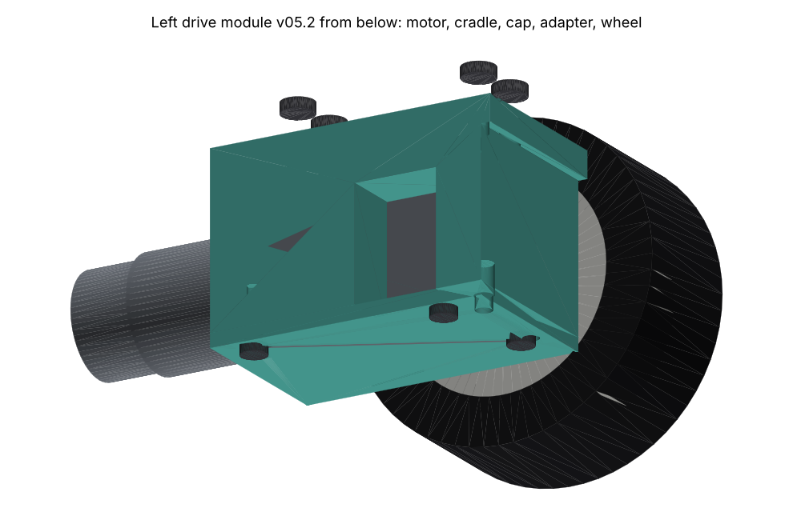
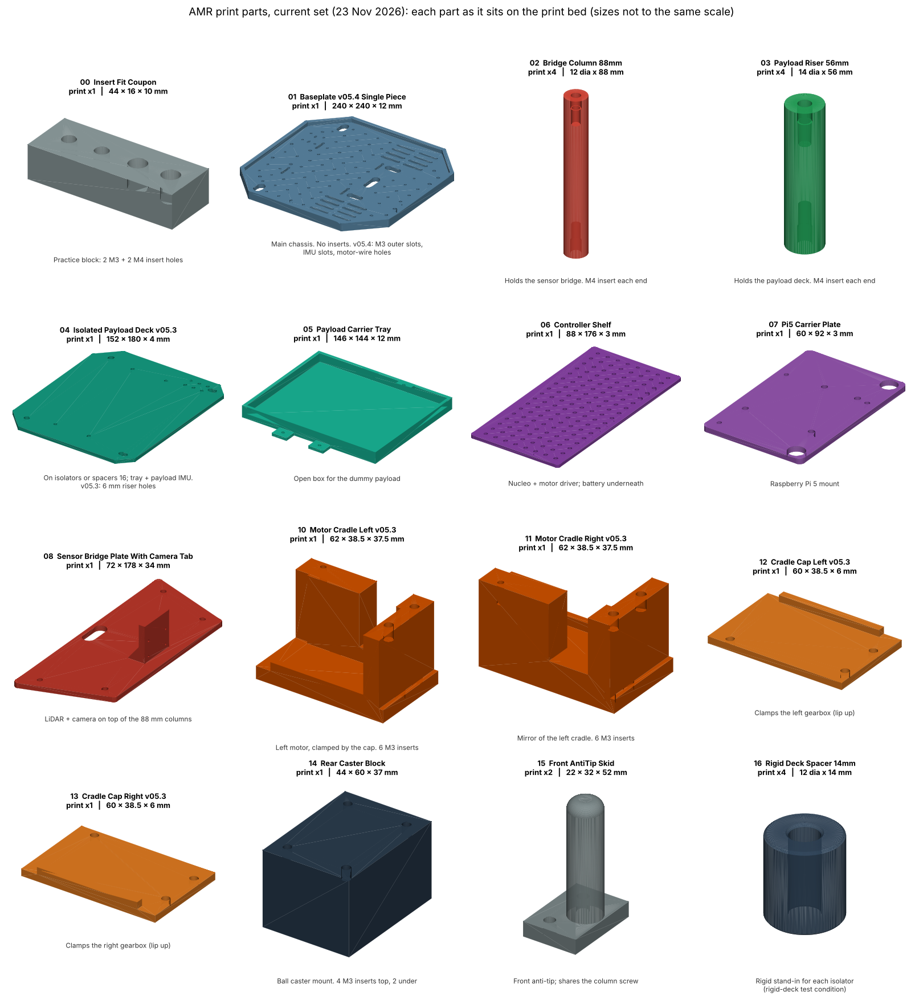

# AMR v05 series: single-piece baseplate robot (current design, revisions v05.3 and v05.4)

This is the design being built in November 2026. It replaces the v04 concept and the v03 split chassis, which are kept in this repository for the design history.

**Status, 17 Nov 2026:** baseplate (part 01) printed; parts 00, 02 to 08 printing; parts 10 to 15 rebuilt from caliper measurements and not yet printed. Nothing has been load tested. The assembly is a CAD concept with purchased parts shown as envelopes; it is not a test result.

**Revision v05.3, 18 to 23 Nov 2026 (print files only; the assembly STEP and renders are still v05.2):**

| Part | What changed, and why |
| --- | --- |
| 01 baseplate v05.3 | The first print had undersize and skinned-over holes, and three holes did not print. Holes enlarged (M3 3.6, M4 4.8, motor slots 4.8 mm), 0.6 mm chamfer under every hole against first-layer squash, two GY-521 slots at the rear left (the original spot sat over the caster block), two 12 x 20 mm motor-wire holes at (-74, +/-96). Same positions, so every other part fits. Generator: `chassis_v05/build_baseplate_v053.py`. |
| 01 baseplate v05.4 (23 Nov) | As v05.3, but the outer two motor-slot rows each side (cradle M3 screws) are 3.6 mm wide: at 4.8 mm the M3 screw and washer did not seat. Inner rows (M4 risers and columns) stay 4.8 mm. Generator: `chassis_v05/build_baseplate_v054.py`. |
| 10 to 13 cradles and caps v05.3 | The v05.2 cradle cracked on the first fit: about 0.25 mm clearance per side and a 2 mm outer wall joined along the layer lines. v05.3 clamps the gearbox between roof and cap (0.3 mm squeeze), with short 3 mm lips and 0.5 mm side clearance. Generator: `robot_v05/build_cradle_v053.py`. |
| 04 deck v05.3 | Rear riser holes 6.0 mm round, front riser holes 6.0 mm slots with 4 mm front-back travel (the front risers sit in motor slots), bigger M3 holes, bottom chamfer. Generator: `robot_v05/build_deck_v053.py`. |
| 16 rigid deck spacer (new, x4) | 14 mm rigid stand-in for each soft isolator, which are not yet sourced: sets the deck at its design height and gives the rigid-deck test condition. |

Checks run on v05.3: valid single solids, watertight single-shell STL, 3MF volume equal to STL, CAD clearance to the motor, adapter and wheel (cradle), rim and nearby holes (new baseplate openings). Physical fit is confirmed only where `docs/build_log` says so. Assembly diagrams for the build are in `docs/assembly/`. `chassis_v05/package/` keeps the original v05 baseplate release for the record.

## Contents

| Path | What it is |
| --- | --- |
| `print_files/STEP`, `print_files/STL` | Every printed part, current revision (00 to 16), in print orientation, millimetres |
| `Vibration_Aware_AMR_v05_2_Concept.step` | Full robot assembly (121 parts) |
| `chassis_v05/` | Baseplate generator and the released baseplate (STEP, STL, 3MF) |
| `robot_v05/` | Robot assembly and print-part generators (cadquery 2.x, trimesh) |
| `checks/` | `PRINT_LIST.csv`, file checks for every part, assembly checks |
| `images/` | Assembly views, left drive module, print-part overview |
| `tools/render_v052.py` | Makes the images from the meshes the generators save |

Regenerate: `cd robot_v05 && python build_print_parts.py --out OUT` (print files) and `python build_robot.py --out OUT` (assembly, checks). The 3MF print copies are generated too but kept out of Git.

## Design summary

- Frame: one-piece printed baseplate 240 x 240 x 12 mm with 45 mm cut corners, for a Bambu X1 Carbon (256 x 256 bed). +X forward, +Y left, origin at plate centre. 70 M3 grid holes on a 20 mm pitch, motor slots, caster, deck and skid holes.
- Drive: 2 x JGY-370-CE worm-gear encoder motors (12 V, 40 RPM) held in printed cradles under the plate, 66.32 mm wheels on 6 mm hex adapters, axle at x = 43 mm, track about 273 mm. Rear 12 mm nylon ball caster on a printed block, two printed front anti-tip skids 3 mm above the floor.
- Layers: baseplate (battery, Pi 5, buck, chassis IMU) -> controller shelf (Nucleo, TB6612, breadboard) -> isolated payload deck on four risers and soft isolators (assumed 14 mm), with tray and payload IMU -> sensor bridge on 88 mm columns (RPLIDAR A1 on top, AI Camera on a front tab).
- Overall 241 x 300 x 206 mm. Baseplate underside 55.0 mm above the floor.

## Measured on 17 November 2026 (vernier calipers)

| Item | Measured | v05.1 assumption |
| --- | --- | --- |
| Wheel diameter | 66.32 mm | 65 mm |
| Wheel width | 26.90 mm | 26 mm |
| Gearbox length x height x thickness | 46.46 x 31.76 x 22.38 mm | 46 x 32 x 25 mm |
| Motor overall length, gearbox end to encoder | 86.6 mm | about 77 mm |
| Gearbox face to wheel inner face | 6.1 mm | about 11 mm |
| Ball caster, mounting face to ball bottom | 18 mm | 15 mm |
| Ball caster slots: width, centre spacing, flange thickness | 3.3, 14.7, 1.9 mm | not known |

Still assumed: the motor shaft is centred top to bottom and 11 mm from the gearbox's free end (a photo agrees roughly; the baseplate slots let each cradle slide 15 mm fore and aft). Motor can diameter and bearing boss are not measured: the cradle leaves a 26 mm opening for the can and an 18 mm slot for the boss. Photos of the measurements are in [docs/build_log/2026-11-17](../../docs/build_log/2026-11-17).

## Checks actually run

- Every print part: valid single solid, watertight STL with one component, 3MF volume matches STL, fits the bed. See `checks/Print_File_Checks.json`.
- Assembly: 121 parts, no positive-volume clashes, STEP re-import works, cradle screws land in the existing baseplate slots. See `checks/Assembly_Checks.json`.
- Drive module interference check: no overlap between the cradle or cap and the gearbox, motor can or wheel; wheel 3.85 mm clear of the cradle and 3.1 mm clear of the baseplate edge.

These are geometry checks only: no FEA, no load test, no printed fit check yet.

## Fastening

Brass heat-set inserts: M3 into 4.0 mm bores, M4 into 5.2 mm bores. Clearance holes 3.4 mm (M3) and 4.5 mm (M4). Printed holes come out slightly small; open them with a drill of the nominal size.

| Where | Insert | Screw |
| --- | --- | --- |
| Both ends of every column and riser (16) | M4 | M4 x 10 with a washer |
| Front two columns, shared with the skids | M4 | M4 x 20 from under the skid |
| Cradle roof, 4 per side | M3 | M3 x 10 down through the baseplate slots |
| Cradle front wall, 2 per side | M3 | M3 x 6 up through the cap |
| Cradle rear wall, 1 per side | none | M3 x 10 into a 2.6 mm hole |
| Caster block top, 4 | M3 | M3 x 10 down through the baseplate |
| Caster block underside, 2 | M3 | M3 x 6 or M3 x 10 through the caster's U-slots, with a washer |
| Tray to deck, 4 / Pi carrier to baseplate, 4 | none | M3 x 10 with a nut |
| Shelf to its standoffs, 4 | none | M3 x 6 |
| Camera to the bridge-plate tab, 4 | none | M2 x 6 into 1.8 mm pilot holes |

LiDAR holes are not in the bridge plate: mark them from the real unit and drill.

