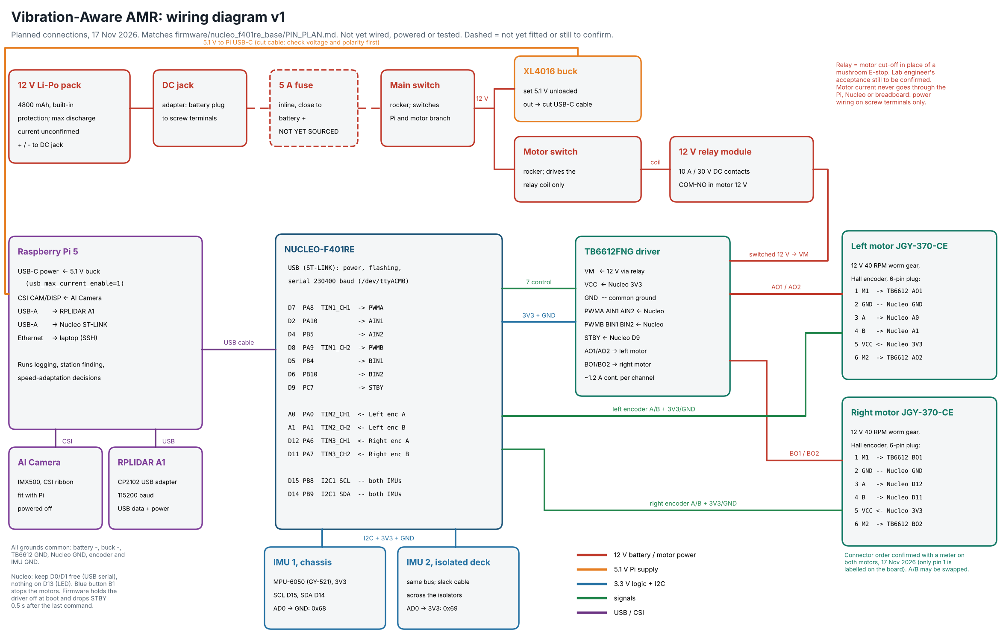

# Wiring diagram

`AMR_Wiring_Diagram_v1` (PNG, SVG, PDF), 17 November 2026. Planned connections for the parts actually bought: NUCLEO-F401RE, TB6612FNG driver, 2 x JGY-370-CE encoder motors, 2 x MPU-6050 IMUs, Raspberry Pi 5, RPLIDAR A1, AI Camera, 12 V Li-Po with buck converter and relay motor cut-off.

**Status:** not yet wired, powered or tested. It matches [firmware/nucleo_f401re_base/PIN_PLAN.md](../../firmware/nucleo_f401re_base/PIN_PLAN.md). Dashed items are not fitted yet (5 A fuse) or still to confirm. The motor encoder connector is labelled only at pin 1; the pin order shown was confirmed with a multimeter on both motors on 17 Nov 2026. The relay cut-off in place of a mushroom E-stop still needs the lab engineer's acceptance.

Regenerate with `python make_wiring_diagram.py OUTDIR` (matplotlib).

It replaces the 28 October connection plan, which was drawn for a different motor and driver (SPG30E + MDD3A) before the STM32 board was identified.

